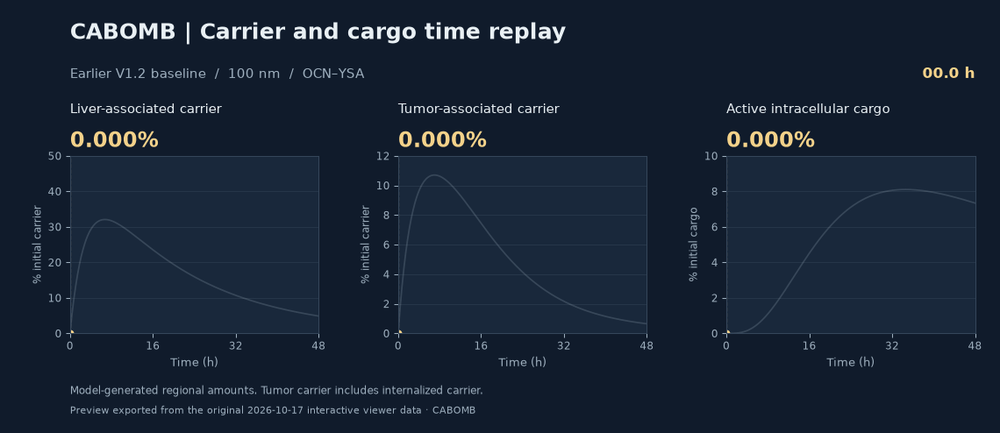
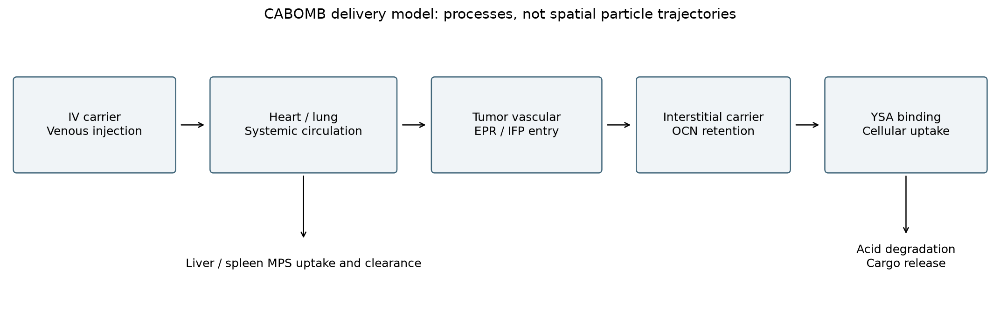
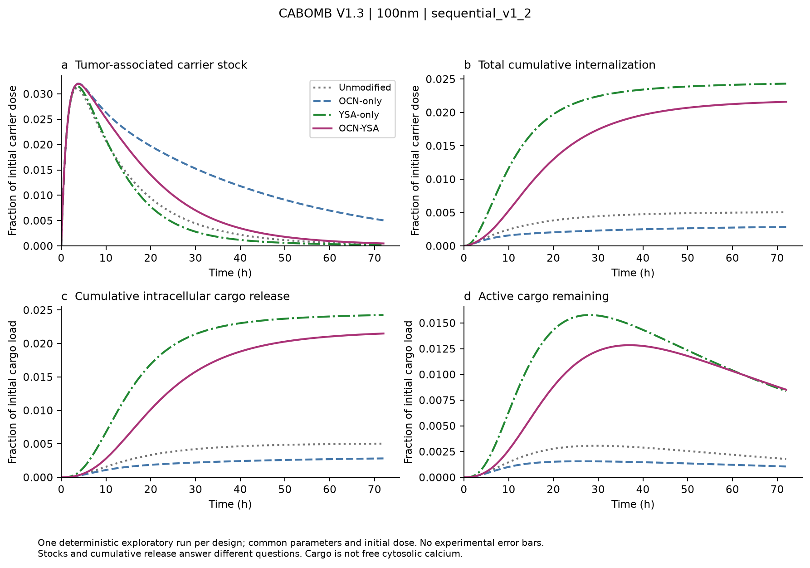
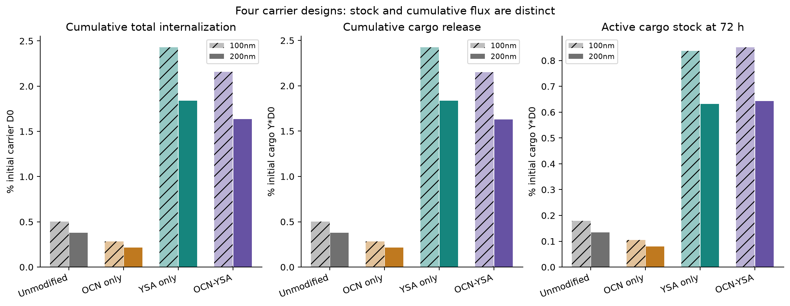

# CABOMB: carrier delivery and release modeling

Modeling code developed for **BNU-China's 2026 iGEM CABOMB project**, with
subsequent personal research extensions.

The amount-based ODE model tracks intravenous CaCO₃ carrier delivery through
circulation, liver and spleen uptake, tumor entry, OCN-mediated retention,
YSA-mediated internalization, and acid-dependent degradation. It compares
unmodified, OCN-only, YSA-only, and OCN–YSA carriers under the same conditions.

The follow-up work asks two connected questions: how much of a late release
curve can be predicted from its early measurements, and how the waiting time
after internalization affects delivery-model outputs.

## Selected figures

### Interactive delivery replay



Liver carrier, tumor-associated carrier and active intracellular cargo share a
0–48 h timeline. This GIF previews the earlier V1.2, 100 nm OCN–YSA visualization.
The [original three-dimensional viewer and source](visualizations/organ_replay/README.md)
are included; download its HTML to play, seek through time and rotate the views.

### Carrier-delivery process



An overview from the earlier CABOMB modeling work: circulation, tumor entry,
OCN retention, YSA-mediated uptake and intracellular release.

### Four carrier designs



V1.3, 100 nm, sequential targeting. The panels show tumor-associated carrier,
total internalization, cumulative cargo release and active cargo remaining.

### Size and design comparison



An earlier comparison of 100 and 200 nm carrier scenarios. Internalization,
cumulative release and the amount of active cargo at 72 hours are shown separately.

More figures from the follow-up analysis are in the [gallery](docs/results_preview.md).

## Usage

Use Python 3.10 or later. From this directory:

```bash
python -m venv .venv
```

Activate the environment with `.venv\Scripts\Activate.ps1` in PowerShell, or
`source .venv/bin/activate` on macOS/Linux, then run:

```bash
python -m pip install ".[dev,app]"
python -m cabomb_model validate-registry
python -m cabomb_model run-baseline --model-version v1.3 --output-dir outputs/baseline
python -m cabomb_release synthetic --output-dir outputs/synthetic
python -m cabomb_release bridge --output-dir outputs/bridge
python -m pytest
```

`synthetic` runs a complete forecasting example, including separate early
inputs, saved forecasts, late scoring, and a figure. `bridge` uses the delivery
model's internalization flux to compare three release-waiting shapes with the
same mean waiting time. Both commands require a new output directory.

For the full delivery analysis and interactive interface:

```bash
python -m cabomb_model run-analysis --model-version v1.3 --output-dir outputs/analysis
python -m streamlit run app/streamlit_app.py
```

The full analysis includes design comparisons, EPR/MPS scenarios, sensitivity,
uncertainty sampling, and mass-balance checks. Pass `--model-version v1.3`
explicitly: the historical CLI default is V1.1. Software version `0.2.0` refers
to this package; V1.1–V1.3 identify model formulations.
For edited parameter files, use the explicit `--registry` option described in
[the run guide](docs/run_guide.md); default runs use the bundled registry.

## What is here

| Location | Contents |
| --- | --- |
| `src/cabomb_model/` | Delivery ODEs, parameter loading, analysis, plotting and reports |
| `src/cabomb_release/` | Release forecasting, rolling selection and age-based convolution |
| `data/processed/` | Model parameter registries, including sources and assumption labels |
| `tests/` | Model invariants, regression checks and forecasting tests |
| `app/` | Streamlit interface |
| `visualizations/organ_replay/` | Earlier offline 3D viewer, animated preview and rebuild sources |
| `docs/` | Equations, model specification and run instructions |
| `research/` | Follow-up protocol, literature sources and research findings |
| `examples/` | Instructions for the executable synthetic example |

[File guide](docs/file_guide.md) · [Research notes](research/findings.md) · [Reproduction](research/REPRODUCIBILITY.md) · [Figures](docs/results_preview.md) ·
[Using your own data](docs/run_guide.md) · [中文说明](README_zh.md)

## Findings so far

The delivery model provides a common basis for comparing carrier designs and
identifying influential transport and binding assumptions. The follow-up study
found that extra release-curve flexibility helped some series but did not
improve average late prediction across the retrospective panel. In the fixed
CABOMB scenario, changing the release-waiting shape affected early response
timing while the four-design ranking stayed the same at the sampled times.

These results guide model choice and the timing of future measurements. The
model is intended for mechanistic exploration and design comparison; its
parameters have not been calibrated to a matched CABOMB experimental dataset.
Details and numerical checks are in [research/findings.md](research/findings.md).

## Author and sources

**高书伦** — model development, code and subsequent analysis. The project retains
its CABOMB / BNU-China iGEM background. Published datasets belong to their
original authors; see [DATA_SOURCES.md](DATA_SOURCES.md) and
[CONTRIBUTIONS.md](CONTRIBUTIONS.md). Literature source attachments are not
bundled; the model, synthetic example and response analysis run without them.

## AI assistance

This project is developed and maintained by 高书伦. I built the original ODE
framework and core code from scratch. During subsequent method exploration and
project preparation, AI tools assisted with literature searches, discussion of
methods, coding, debugging and documentation. A separate AI agent also checked
parts of the code and results.

AI-generated content can contain errors; conclusions should be read alongside
the source literature, code and validation records. AI-assisted checks do not
constitute human peer review.

The CABOMB team background is retained. Cited publications and public datasets
belong to their original authors and are attributed separately.

## License and citation

Original code is offered under the [MIT License](LICENSE). Third-party materials
retain their own terms; see [NOTICE.md](NOTICE.md). Use [CITATION.cff](CITATION.cff)
to cite the software and cite the original papers when using their data.
