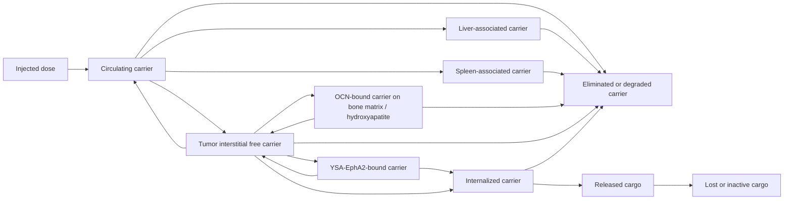

# CABOMB V1.1 Model Specification

This document specifies the CABOMB V1.1 compartmental ODE model implemented in
`src/cabomb_model/`.

## V1.1 exploratory OCN cellular access

The executable state vector remains the ten states listed below. There is no
`A_dual_bound` state. The dimensionless registry parameter
`alpha_ocn_cell_access` has baseline 0, bounds `[0, 1]`, assumed exploratory
value type, and low confidence. It denotes effective YSA-EphA2 cellular access
retained by OCN-bound carrier relative to tumor-free carrier. It is not a
measured probability or experimentally validated transition rate.

Only the OCN-YSA design activates the phenomenological transfer

```text
J_ocn_to_ysa =
  I_OCN I_YSA alpha_ocn_cell_access
  k_ysa_on R_EphA2_eff A_ocn_bound
```

The flux is subtracted from `A_ocn_bound` and added equally to `A_ysa_bound`,
preserving the carrier ledger. It does not modify blood flow, permeability,
EPR, IFP, or tumor entry. All four designs share the same systemic parameters.
At alpha zero, V1.1 reproduces the accepted V1 state trajectories and original
metrics. No parameter is tuned to guarantee OCN-YSA superiority over YSA-only.

Reported quantities are classified explicitly: state stock is amount present
at one time; exposure AUC integrates stock over time; cumulative flux integrates
gross process throughput. Cumulative fluxes are postprocessed from saved
trajectories and are not added as ODE states.

## Compartment Diagram



## State Variables

State variables should be carrier amounts where possible. Concentrations are
derived as amount divided by compartment volume.

| Symbol | State | Suggested Unit |
| --- | --- | --- |
| `A_blood` | circulating carrier in blood/central compartment | carrier amount, e.g. mg CaCO3 or particle count |
| `A_liver` | liver-associated carrier | carrier amount |
| `A_spleen` | spleen-associated carrier | carrier amount |
| `A_tumor_free` | free carrier in tumor interstitium | carrier amount |
| `A_ocn_bound` | OCN-retained carrier bound to bone matrix/hydroxyapatite | carrier amount |
| `A_ysa_bound` | YSA-EphA2-bound carrier | carrier amount |
| `A_internalized` | cellular internalized carrier | carrier amount |
| `A_elim_deg` | eliminated or degraded carrier | carrier amount |
| `A_cargo` | released active cargo still counted as available cargo | cargo amount, not carrier mass |
| `A_cargo_lost` | released cargo lost, exported, degraded, or payload removed with terminal carrier loss | cargo amount, not carrier mass |

`A_cargo_lost` is a ledger state. It is included so that cargo accounting can be
checked separately from carrier accounting. If the first executable model omits
released-cargo decay by setting `k_cargo_loss = 0`, this state should still
receive payload removed with carrier elimination pathways that do not produce
active intracellular cargo.

## Parameters

Parameter names are draft symbols. Values must come from
`data/processed/parameters_master.csv` or be explicitly marked missing before
use.

| Symbol | Meaning | Unit |
| --- | --- | --- |
| `D0` | injected carrier dose | carrier amount |
| `Vblood`, `Vliv`, `Vspl`, `Vtum` | compartment volumes, with readable code aliases allowed such as `V_blood` | L or mL |
| `Qliv`, `Qspl`, `Qtum` | blood-flow terms, with readable code aliases allowed such as `Q_liver` | L/time |
| `k_liver_uptake`, `k_spleen_uptake` | MPS uptake from blood | 1/time |
| `k_liver_elim`, `k_spleen_elim` | elimination/degradation from organ-associated states | 1/time |
| `k_blood_clear` | non-liver/spleen systemic loss | 1/time |
| `Pcap_tumor`, `P_EPR`, `IFP_tumor_project` | permeability/EPR/pressure variables governing tumor entry | source-dependent |
| `k_entry` | effective blood-to-tumor entry rate after EPR/IFP adjustment | 1/time |
| `k_return` | tumor free-to-blood return or washout | 1/time |
| `I_OCN`, `I_YSA` | design switches for OCN and YSA modules | 0 or 1 |
| `k_ocn_on`, `k_ocn_off` | OCN-hydroxyapatite binding and release rates | 1/time or concentration-normalized |
| `k_ysa_on`, `k_ysa_off` | YSA-EphA2 binding and release rates | concentration-normalized and 1/time |
| `R_EphA2_eff` | effective EphA2 availability | concentration or normalized density |
| `k_int` | internalization of receptor-bound carrier | 1/time |
| `k_int_ns` | non-specific internalization of free tumor carrier | 1/time |
| `k_deg_int(pH)` | acid-dependent intracellular carrier degradation, parameterized at minimum by `k_deg_phys` and `k_deg_int_acid` | 1/time |
| `k_tumor_deg`, `k_ocn_loss` | local degradation/loss from free or OCN-bound states | 1/time |
| `Y_cargo` | released cargo yield per degraded carrier amount | cargo/carrier |
| `k_cargo_loss` | effective cargo decay/export/loss | 1/time |

## Flow Definitions

- `k_entry` represents local tumor entry after circulation has delivered carrier
  to tumor vasculature. It may depend on permeability, EPR scenario, particle
  size, and IFP. It must not be increased by OCN or YSA switches.
- `I_OCN` only activates OCN matrix binding/retention.
- `I_YSA` only activates YSA-EphA2 binding and receptor-mediated
  internalization.
- MPS uptake is represented as effective liver and spleen uptake until
  CaCO3-specific kinetics are supplied.
- Blood flow (`Q*`), vascular permeability (`Pcap_tumor`), EPR pore
  size, IFP, binding energy, and docking scores are not first-order ODE rates by
  themselves. They may only be used through a documented entry or binding
  function that returns a correctly dimensioned rate such as `k_entry` in
  `h^-1` or a concentration-normalized association term.
- The model time unit for first implementation should be hours. Any source value
  supplied in minutes, seconds, cm/s, mmHg, nm, or L/min must be converted or
  combined through a documented formula before use in an ODE term.

## ODE Draft

One acceptable first draft is:

```text
dA_blood/dt =
  - (k_liver_uptake + k_spleen_uptake + k_entry + k_blood_clear) A_blood
  + k_return A_tumor_free

dA_liver/dt =
  k_liver_uptake A_blood - k_liver_elim A_liver

dA_spleen/dt =
  k_spleen_uptake A_blood - k_spleen_elim A_spleen

dA_tumor_free/dt =
  k_entry A_blood
  - k_return A_tumor_free
  - I_OCN k_ocn_on A_tumor_free + I_OCN k_ocn_off A_ocn_bound
  - I_YSA k_ysa_on R_EphA2_eff A_tumor_free + I_YSA k_ysa_off A_ysa_bound
  - k_int_ns A_tumor_free
  - k_tumor_deg A_tumor_free

dA_ocn_bound/dt =
  I_OCN k_ocn_on A_tumor_free
  - I_OCN k_ocn_off A_ocn_bound
  - I_OCN k_ocn_loss A_ocn_bound

dA_ysa_bound/dt =
  I_YSA k_ysa_on R_EphA2_eff A_tumor_free
  - I_YSA k_ysa_off A_ysa_bound
  - I_YSA k_int A_ysa_bound

dA_internalized/dt =
  I_YSA k_int A_ysa_bound
  + k_int_ns A_tumor_free
  - k_deg_int(pH) A_internalized

dA_elim_deg/dt =
  k_blood_clear A_blood
  + k_liver_elim A_liver
  + k_spleen_elim A_spleen
  + k_tumor_deg A_tumor_free
  + I_OCN k_ocn_loss A_ocn_bound
  + k_deg_int(pH) A_internalized

dA_cargo/dt =
  Y_cargo k_deg_int(pH) A_internalized
  - k_cargo_loss A_cargo

dA_cargo_lost/dt =
  Y_cargo (
    k_blood_clear A_blood
    + k_liver_elim A_liver
    + k_spleen_elim A_spleen
    + k_tumor_deg A_tumor_free
    + I_OCN k_ocn_loss A_ocn_bound
  )
  + k_cargo_loss A_cargo
```

`A_cargo` is not included in carrier mass conservation because it represents
released payload, not intact carrier mass. `A_cargo_lost` is not included in
carrier mass conservation either. It is included only in the separate cargo
ledger.

## Initial Conditions

At IV bolus start:

```text
A_blood(0) = D0
A_liver(0) = 0
A_spleen(0) = 0
A_tumor_free(0) = 0
A_ocn_bound(0) = 0
A_ysa_bound(0) = 0
A_internalized(0) = 0
A_elim_deg(0) = 0
A_cargo(0) = 0
A_cargo_lost(0) = 0
```

Alternative infusion input may replace the bolus later, but is out of scope for
this phase.

## Boundary Conditions and Constraints

- All state variables must remain non-negative within solver tolerance.
- All rate constants must be non-negative.
- `k_entry` must be non-increasing as IFP increases, all else equal.
- `k_entry` must be non-decreasing as permeability/EPR strength increases, all
  else equal.
- Setting `D0 = 0` must produce zero carrier and cargo amounts for all times.
- Setting `I_OCN = 0` must remove all OCN-specific effects.
- Setting `I_YSA = 0` must remove YSA-EphA2 binding and YSA-driven
  internalization.
- Changing `k_int` must not directly change `k_entry` or initial tumor blood
  delivery.
- If acid response is enabled, `k_deg_int(pH_acidic)` must be greater than
  `k_deg_int(pH_7.4)`.
- With standard initial conditions, `I_OCN = 0` must keep `A_ocn_bound = 0` for
  all simulated times, and `I_YSA = 0` must keep `A_ysa_bound = 0` for all
  simulated times.

## Design Comparisons

| Design | `I_OCN` | `I_YSA` | Expected mechanistic difference |
| --- | --- | --- | --- |
| unmodified | 0 | 0 | No OCN matrix retention and no YSA-EphA2 binding. |
| OCN-only | 1 | 0 | Increased local matrix retention after tumor-region arrival. |
| YSA-only | 0 | 1 | Increased EphA2 binding and receptor-mediated internalization after tumor-region arrival. |
| OCN-YSA | 1 | 1 | Combines matrix retention and receptor binding/internalization. |

The design switches must not change tumor blood-flow allocation or EPR entry by
themselves.

## EPR Scenarios

EPR is represented by scenario labels until validated numerical values are
registered:

- Low EPR: poor vascular leakiness, high barriers, weak tumor entry.
- Medium EPR: nominal exploratory condition.
- High EPR: favorable tumor entry condition.

These scenarios should alter `k_entry` or an upstream dimensionless EPR factor,
not the OCN/YSA binding parameters. IFP scenarios should be handled separately
or as part of the `k_entry` function, with higher IFP reducing entry.

## Output Metrics

- Time profiles for all carrier states and released cargo.
- Peak and area-under-curve for `A_tumor_free`, `A_ocn_bound`,
  `A_ysa_bound`, `A_internalized`, `A_cargo`, and `A_cargo_lost`.
- Fraction of initial dose in liver, spleen, tumor-associated states, and
  eliminated/degraded state.
- Design ranking under low/medium/high EPR and low/medium/high MPS clearance.
- Mass-balance residual:

```text
carrier_total(t) =
  A_blood + A_liver + A_spleen + A_tumor_free + A_ocn_bound
  + A_ysa_bound + A_internalized + A_elim_deg

mass_balance_residual(t) = carrier_total(t) - D0
```

The separate cargo ledger is:

```text
active_carrier_total(t) =
  A_blood + A_liver + A_spleen + A_tumor_free + A_ocn_bound
  + A_ysa_bound + A_internalized

cargo_total(t) =
  Y_cargo active_carrier_total(t) + A_cargo + A_cargo_lost

cargo_balance_residual(t) = cargo_total(t) - Y_cargo D0
```

This ledger treats payload removed with terminal carrier elimination pathways as
lost or inactive cargo unless a later evidence-backed submodel separately tracks
active release outside the intracellular compartment.

## Verification Plan

- Mass balance: `carrier_total(t)` should equal `D0` within numerical tolerance.
- Cargo balance: `cargo_total(t)` should equal `Y_cargo D0` within numerical
  tolerance when `Y_cargo` is defined.
- Non-negativity: each state should remain at or above a small negative solver
  tolerance.
- Zero dose: all states remain zero.
- Targeting removal: OCN and YSA switch-off tests remove corresponding terms.
- Internalization independence: increasing `k_int` changes downstream bound and
  internalized states but does not change `k_entry`.
- Permeability/IFP monotonicity: decreasing permeability or increasing IFP
  reduces tumor entry under the selected entry function.
- Acid degradation: acidic pH causes faster degradation than pH 7.4 when the
  acid-response relationship is enabled.
- Reproducibility: any stochastic uncertainty analysis must use fixed seeds.

## Specification Freeze Review Notes

- OCN-specific transfer terms are switch-gated on both source and destination
  equations. This prevents an OCN-off design from retaining any OCN matrix
  binding, release, or OCN-bound loss behavior.
- YSA-specific transfer terms are switch-gated on both source and destination
  equations. This prevents a YSA-off design from retaining EphA2 binding,
  unbinding, or receptor-mediated internalization behavior.
- `A_cargo_lost` was added as a ledger state because `A_cargo` alone cannot
  close a payload balance when released cargo can decay/export or when terminal
  carrier loss removes unreleased payload from the modeled active system.
- Source variables such as blood flow, permeability, pore size, IFP, binding
  energy, or docking score require a documented conversion model before they can
  affect an ODE rate. They are not dimensionally valid substitutes for `h^-1`
  constants.

## V1.2 optional saturable-MPS and sequential-targeting modes

V1.2 retains all ten states. It introduces no MPS state, `A_dual_bound`, or
receptor state. The explicit pairs are `linear_v1 + accessibility_v1_1` for
V1.1 and `saturable_v1_2 + sequential_v1_2` for V1.2.

```text
C_blood = A_blood / Vblood
J_liver_uptake = mps_factor * Vmax_liver * C_blood / (Km_liver + C_blood)
J_spleen_uptake = mps_factor * Vmax_spleen * C_blood / (Km_spleen + C_blood)
J_liver_release = k_liver_release * A_liver
J_spleen_release = k_spleen_release * A_spleen
```

Intact release returns equally to `A_blood`; irreversible organ loss enters
`A_elim_deg`. `C_blood` is normalized carrier per apparent volume, not mg/L.
`Vmax_liver`, `Km_liver`, `k_liver_release`, `Vmax_spleen`, `Km_spleen`, and
`k_spleen_release` are low-confidence exploratory assumptions.

For `sequential_v1_2`, the OCN-YSA design follows
`A_tumor_free -> A_ocn_bound -> A_ysa_bound -> A_internalized` through
`J_ocn_to_ysa = I_OCN * I_YSA * k_cross * R_EphA2_eff * A_ocn_bound`.
The direct free-to-YSA term is disabled only for double-modified sequential
carrier. `k_cross` is an exploratory rate, not a measured probability or
validated receptor-binding constant. This sequential structure assumption is
not a dynamic receptor or receptor-saturation model.
