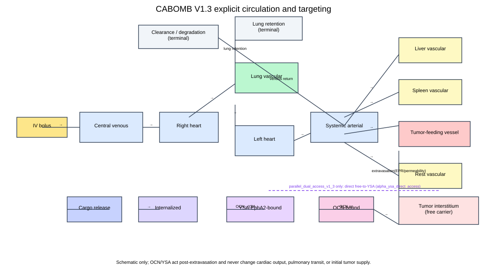
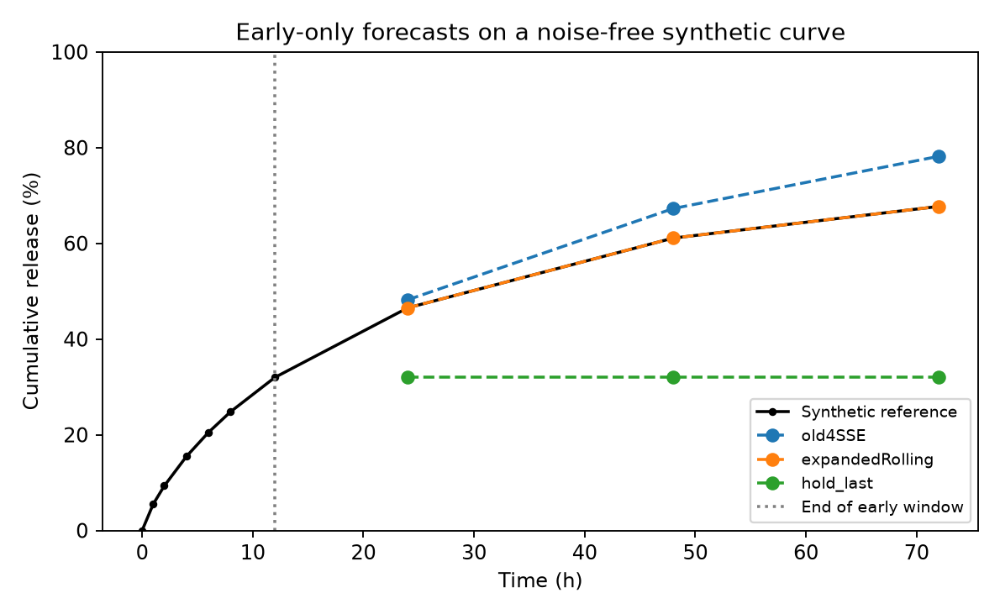
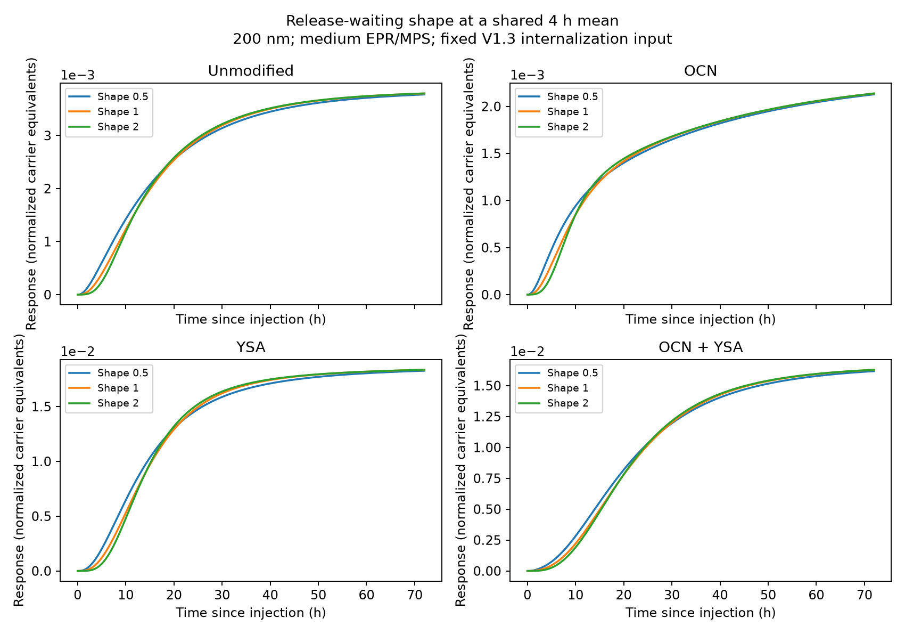

# Result preview

## Earlier interactive visualization

The original liver, tumor-tissue and intracellular viewer is included with its
source and asset credits. Its saved V1.2 100 nm baseline is replayed here as a
GIF; [open/download instructions](../visualizations/organ_replay/README.md) cover
the interactive 3D version.

## Earlier CABOMB figures

These original figures are retained from the author's earlier modeling work.
Source filenames, model context and image checksums are recorded in
`../assets/previous_work/sources.json`.

### Delivery process

Circulation and MPS uptake lead into tumor entry, matrix retention, cellular
uptake and acid-dependent release.

### Four-design time courses

The 100 nm V1.3 sequential scenario separates carrier stock, internalization,
cumulative release and active cargo. Each design uses the same initial dose
and parameter setting.

### Size and design metrics

The earlier presentation compares four designs at two assumed carrier sizes.
The displayed quantities are model-generated fractions of initial carrier
or cargo; panel labels identify each denominator.

## Delivery-model structure

The amount-based model separates circulation and organ passage from tumor
entry, binding and internalization. OCN and YSA act after tumor-region arrival.

## Synthetic forecasting example

The vertical line marks the end of the observed early window. Forecasts use
those observations; later values are scored separately. This noise-free example
illustrates the runnable workflow. Experimental comparisons are discussed in
the research notes.

## Release-waiting comparison

Each panel uses its own y-axis scale. Three assumed waiting shapes share a
four-hour mean and the same model-generated internalization input for that
design. Their early timing differs, while late responses approach one another.
Units are normalized carrier equivalents. The input and output CSVs are saved
separately when the commands run.
