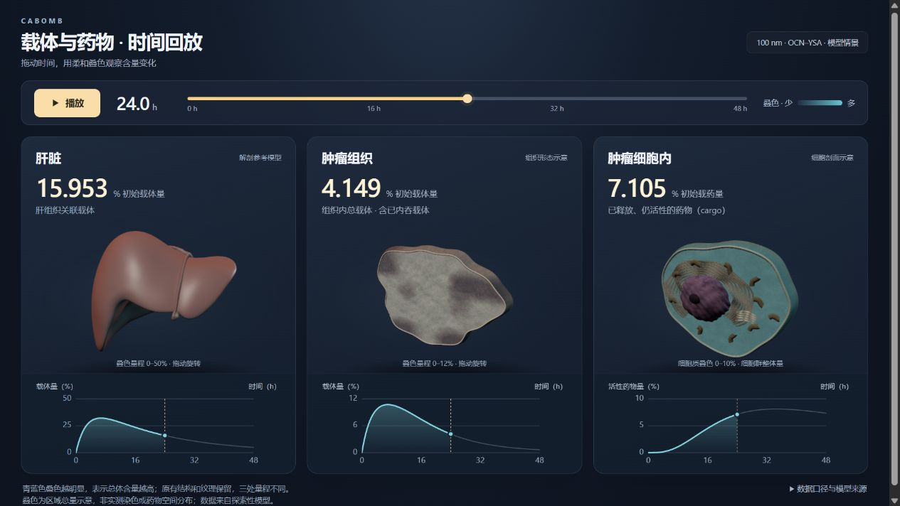

# CABOMB interactive time replay

An earlier visualization by 高书伦 for the CABOMB modeling work. It links liver
carrier, tumor-associated carrier and active intracellular cargo to one shared
0–48 hour timeline. The original three-dimensional page and its rebuild sources
are retained here unchanged.



## Open the interactive version

Download [index.html](index.html) using GitHub's **Download raw file** button,
then open the downloaded file in a desktop browser. Playback, time seeking and
model rotation work offline; no Python installation is needed. GitHub displays
HTML source rather than running the page in the repository view.

## Animated curve preview


This GIF was exported for the GitHub presentation from the earlier viewer's
saved data. It follows the same linear interpolation as the interactive page;
the ODE model was not rerun. Cyan traces the elapsed curve, gold marks the
current time, and the faint line shows the complete saved course. In this
scenario, carrier association peaks earlier than active intracellular cargo.
To regenerate it from the repository root:

```bash
python scripts/render_replay_preview.py
```

## Model context

This is the **2026-10-17 V1.2 Wiki baseline**: 100 nm OCN–YSA, 125 accessible YSA,
medium EPR, linear MPS and instant cross-talk. It is a separate historical
scenario from the V1.3 examples elsewhere in this repository.

Liver and tumor carrier use percent of initial carrier; intracellular active
cargo uses percent of initial cargo. Tumor carrier includes the internalized
pool. The three values describe overlapping model quantities and should not
be added together. The three-dimensional coloring shows regional amounts over
illustrative geometry, rather than a predicted spatial concentration field.

`data_manifest.json` records the original scenario and data provenance.
`provenance.json` identifies the unchanged source files and their checksums.
The original browser QA record is retained as
`historical_browser_validation_20261017.json`; it describes the earlier check,
not a new browser run during this GitHub packaging step.

## Rebuild the offline page

The saved `data.json` and liver geometry are included. From this directory,
using a supported Node.js environment:

```bash
npm ci
npm run build
```

Rebuilding bundles the existing data and display code; it does not calculate
a new biological scenario.

## Credits

Visualization code, procedural tumor and cell illustrations, and CABOMB model
work: **高书伦**, with the BNU-China 2026 iGEM CABOMB team background retained.

The liver geometry is the **HuBMAP / Human Reference Atlas Visible Human male
reference liver**, released under **CC BY 4.0**. Three.js is **MIT** licensed.
See [ATTRIBUTION.md](ATTRIBUTION.md) and
[the retained Three.js license](assets/THREE-LICENSE.txt). These third-party
materials retain their own terms.
